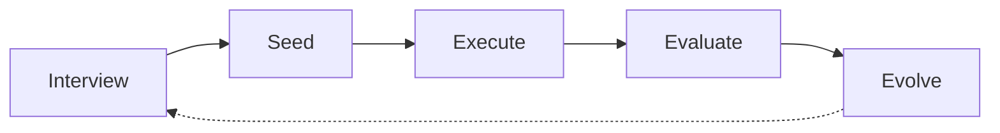

# Lee Sang Gyu (이상규)

**Co-founder, [Ouro Labs](https://ourolabs.vercel.app/)** · **Core Maintainer, [Ouroboros](https://github.com/Q00/ouroboros)**

<!-- AUTO-BADGES:START -->

[-4338CA?style=flat-square&logo=github&logoColor=white)](https://github.com/Q00/ouroboros/pulls?q=is%3Apr+author%3Alee3Q+is%3Amerged)

<!-- AUTO-BADGES:END -->

---

## I begin with distrust.

I do not believe suffering can be eliminated. I cannot take my own judgment, my will, or the systems I build for granted.

I want to understand why I waver, why the world resists my understanding, and how I can continue to pursue what I believe in despite it.

Literature once gave form to something I could not articulate. I want to create things capable of doing the same.

Research, writing, and software are the means I have chosen.

---

## Main Work

### [Ouroboros](https://github.com/Q00/ouroboros)

**Core Maintainer · Open-source Agent OS**

I see Ouroboros as an architecture built around distrust — not only of the agent, but also of our own understanding of what we want.

A human request is not necessarily a clear intention. An agent's claim is not necessarily evidence. Even a specification can be incomplete.

Ouroboros addresses these problems through questioning, specification, observable execution, evaluation, and evolution.

Question the intention. Record the execution. Verify the outcome. Revise what remains unresolved.

My contributions focus on:

- Execution reliability and recovery
- Evidence integrity and verification
- Agent runtimes and safety boundaries
- Intent clarification and drift control

My next direction is to make human intervention meaningful throughout the creative process, allowing people to examine and revise what is being made before the final result.

[Repository](https://github.com/Q00/ouroboros) · [Architecture & Philosophy](https://github.com/Q00/ouroboros/blob/main/docs/how-ouroboros-works.md) · [My merged contributions](https://github.com/Q00/ouroboros/pulls?q=is%3Apr+author%3Alee3Q+is%3Amerged)

<b>Detailed Ouroboros contributions and current project metrics</b>

<!-- AUTO-OUROBOROS:START -->
### [Ouroboros](https://github.com/Q00/ouroboros) · ⭐ 6.4k — *Core Maintainer*

**Open-source Agent OS for Specification-First AI Software Development**

I am a core maintainer of **Ouroboros** and a co-founder of **[Ouro Labs](https://ourolabs.vercel.app/)**. My work focuses on turning ambiguous human requests into explicit specifications (`Seed`), coordinating multi-runtime agent execution, and preserving verifiable evidence so people can audit the outcome.

- **Verification & Evidence Integrity:** Binding file-modification claims to observed tool-call receipts, isolating source checks from runtime assertions, and rejecting malformed semantic evaluation scores.
- **Execution & Lifecycle Recovery:** Background-job polling and recovery, cancellation lifecycle management, checkpoint compatibility, and unified runner assembly.
- **Multi-Runtime Adapters & Diagnostics:** Zcode runtime and LLM adapters, Antigravity stream normalization, provider routing across OpenAI/Anthropic/Gemini, and `doctor` MCP/installation probes.
- **Intent Alignment & Drift Control:** Structured ambiguity ledgers (`B2`), semantic goal-drift checks, unanswered interview round floors, and locale-independent UTF-8 handling.

👉 **[All 57 merged PRs in `Q00/ouroboros`](https://github.com/Q00/ouroboros/pulls?q=is%3Apr+author%3Alee3Q+is%3Amerged)**

<b>Selected Ouroboros contributions by subsystem</b>

 

| Area | Scope | Merged PRs |
| :--- | :--- | :--- |
| **Verification & Evidence** | Bound `pathlib` write claims to execution records; linked wrapper test receipts to accepted Bash attempts; separated source checks from runtime assertions; captured native tool evidence; rejected malformed semantic scores. | [#1764](https://github.com/Q00/ouroboros/pull/1764), [#2639](https://github.com/Q00/ouroboros/pull/2639), [#2640](https://github.com/Q00/ouroboros/pull/2640), [#2745](https://github.com/Q00/ouroboros/pull/2745), [#2749](https://github.com/Q00/ouroboros/pull/2749), [#2758](https://github.com/Q00/ouroboros/pull/2758), [#2842](https://github.com/Q00/ouroboros/pull/2842) |
| **Orchestrator & Job Recovery** | Hardened MCP background-job polling and recovery; recovered artifact contracts and QA environments; extracted Phase 3 cancellation lifecycle; unified public run builder assembly; bounded workspace fingerprint scans. | [#1622](https://github.com/Q00/ouroboros/pull/1622), [#1630](https://github.com/Q00/ouroboros/pull/1630), [#2567](https://github.com/Q00/ouroboros/pull/2567), [#2635](https://github.com/Q00/ouroboros/pull/2635), [#2636](https://github.com/Q00/ouroboros/pull/2636), [#2637](https://github.com/Q00/ouroboros/pull/2637), [#2638](https://github.com/Q00/ouroboros/pull/2638), [#2746](https://github.com/Q00/ouroboros/pull/2746), [#2748](https://github.com/Q00/ouroboros/pull/2748) |
| **Runtime Adapters & Diagnostics** | Implemented Zcode runtime backend and LLM adapter; built installation `doctor` and local stdio MCP probes; hardened Codex cold starts and locale-independent UTF-8 seed/source decoding. | [#1568](https://github.com/Q00/ouroboros/pull/1568), [#1595](https://github.com/Q00/ouroboros/pull/1595), [#2034](https://github.com/Q00/ouroboros/pull/2034), [#2406](https://github.com/Q00/ouroboros/pull/2406), [#2411](https://github.com/Q00/ouroboros/pull/2411), [#2420](https://github.com/Q00/ouroboros/pull/2420), [#2499](https://github.com/Q00/ouroboros/pull/2499), [#2564](https://github.com/Q00/ouroboros/pull/2564), [#2846](https://github.com/Q00/ouroboros/pull/2846), [#2847](https://github.com/Q00/ouroboros/pull/2847), [#2860](https://github.com/Q00/ouroboros/pull/2860) |
| **Intent Alignment & Routing** | Built typed ambiguity evidence ledger (`B2`); floored ambiguity for unanswered interview rounds; semantic goal-drift checks; quality-first model routing and OpenAI/Anthropic/Gemini compatibility. | [#2415](https://github.com/Q00/ouroboros/pull/2415), [#2417](https://github.com/Q00/ouroboros/pull/2417), [#2642](https://github.com/Q00/ouroboros/pull/2642), [#2643](https://github.com/Q00/ouroboros/pull/2643), [#2660](https://github.com/Q00/ouroboros/pull/2660), [#2668](https://github.com/Q00/ouroboros/pull/2668), [#2669](https://github.com/Q00/ouroboros/pull/2669), [#2673](https://github.com/Q00/ouroboros/pull/2673), [#2819](https://github.com/Q00/ouroboros/pull/2819) |
| **Additional & Recent Merged PRs** | Continuing maintenance across CLI, runtime adapters, docs, and verification checks. | [#2857](https://github.com/Q00/ouroboros/pull/2857), [#2838](https://github.com/Q00/ouroboros/pull/2838), [#2837](https://github.com/Q00/ouroboros/pull/2837), [#2824](https://github.com/Q00/ouroboros/pull/2824), [#2776](https://github.com/Q00/ouroboros/pull/2776), [#2647](https://github.com/Q00/ouroboros/pull/2647), [#2646](https://github.com/Q00/ouroboros/pull/2646), [#2645](https://github.com/Q00/ouroboros/pull/2645), [#2644](https://github.com/Q00/ouroboros/pull/2644), [#2641](https://github.com/Q00/ouroboros/pull/2641), [#2634](https://github.com/Q00/ouroboros/pull/2634), [#2633](https://github.com/Q00/ouroboros/pull/2633) |

<!-- AUTO-OUROBOROS:END -->

### [OOO Seed](https://ourolabs.vercel.app/seed/)

**Bringing Ouroboros into practice**

A technology is not meaningful simply because its architecture is convincing. It must encounter real people, their problems, and their limitations.

OOO Seed is a hands-on community where professionals, founders, and domain experts explore AI through their own work.

Through Ouro Labs, I help develop a culture in which people question AI outputs, establish their own criteria, build things, and examine what actually works.

For me, Seed is an opportunity to bring these ideas beyond software and into the lives of people.

---

## Personal Research & Projects

### [Codbeing](https://github.com/lee3Q/codbeing)

**Why do I waver?**

An exploration of human judgment, behavior, and the gap between conviction and action.

Codbeing separates decisions from hindsight and compares anticipated choices with actual behavior. Its long-term direction is to explore probabilistic models of human decisions under changing psychological, physiological, and environmental conditions.

### [Human30](https://github.com/lee3Q/human30)

**What happens when the conditions change?**

An exploratory simulation of human behavior and collective interaction.

Human30 investigates how fictional individuals with different bodies, memories, identities, and contexts respond to the same situation, and how changing those conditions alters their interactions.

### Companion Core — formerly [Pullim](https://github.com/lee3Q/pullim)

**What remains when everything feels uncertain?**

A project that began with the desire to create something that would remain present when a person could no longer make sense of their own thoughts.

Its direction extends toward persistent agent memory, continuity of interaction, consent, and emotional companionship without surrendering the individual's ability to decide.

### Agent Environment Simulation

*Research direction*

An extension of Codbeing and Human30 into environments where agents interact, negotiate, cooperate, and compete.

I want to investigate how individual decision-making and collective outcomes change under different rules, information constraints, and incentives.

---

## Open-Source Contributions

My engineering work focuses on reliability, verification, runtime behavior, protocol correctness, and software security.

I maintain Ouroboros and contribute to open-source projects across multiple languages and ecosystems.

<!-- AUTO-OSS:START -->
| Project | Stars | Stack | Merged Contributions |
| :--- | :---: | :--- | :--- |
| **[Oh My ClaudeCode (OMC)](https://github.com/Yeachan-Heo/oh-my-claudecode)** | ⭐ 41.1k | `TypeScript` | Preflight context-threshold validation and read-budget env override guards preventing malformed values from silently activating ([#4069](https://github.com/Yeachan-Heo/oh-my-claudecode/pull/4069), [#4070](https://github.com/Yeachan-Heo/oh-my-claudecode/pull/4070), [#4071](https://github.com/Yeachan-Heo/oh-my-claudecode/pull/4071)) |
| **[Oh My Codex (OMX)](https://github.com/Yeachan-Heo/oh-my-codex)** | ⭐ 33.9k | `TypeScript` | Stripping OSC terminal-control sequences from notification text and surfacing resolved config paths in `doctor` ([#3691](https://github.com/Yeachan-Heo/oh-my-codex/pull/3691), [#3693](https://github.com/Yeachan-Heo/oh-my-codex/pull/3693), [#3694](https://github.com/Yeachan-Heo/oh-my-codex/pull/3694)) |
| **[OpenCodex](https://github.com/lidge-jun/opencodex)** | ⭐ 18.8k | `TypeScript / Bun` | Portable Bun test batch execution for macOS environments without GNU `timeout` ([#5456](https://github.com/lidge-jun/opencodex/pull/5456)) |
| **[Pillow](https://github.com/python-pillow/Pillow)** | ⭐ 14.0k | `Python / C` | Raising `SyntaxError` when a SPIDER image within a stack is opened directly ([#10425](https://github.com/python-pillow/Pillow/pull/10425)) |
| **[LZ4](https://github.com/lz4/lz4)** | ⭐ 12.9k | `C` | Aligning pass-through behavior for `--stdout`/`--to-stdout` with `-c`, and extra-operand handling for `--force`/`--no-force` with `-f` ([#2062](https://github.com/lz4/lz4/pull/2062), [#2075](https://github.com/lz4/lz4/pull/2075)) |
| **[dust](https://github.com/bootandy/dust)** | ⭐ 12.7k | `Rust` | Reject min-size values that overflow ([#647](https://github.com/bootandy/dust/pull/647)) |
| **[SQLFluff](https://github.com/sqlfluff/sqlfluff)** | ⭐ 10.0k | `Python` | Hive dialect `GROUP BY` grammar support for trailing `WITH ROLLUP` and `WITH CUBE` clauses ([#8974](https://github.com/sqlfluff/sqlfluff/pull/8974)) |
| **[javalin](https://github.com/javalin/javalin)** | ⭐ 8.4k | `Kotlin` | Fix NPE in FileUtil.streamToFile for paths without a parent directory ([#2697](https://github.com/javalin/javalin/pull/2697)); Escape all JSON control characters in JsonEscapeUtil ([#2698](https://github.com/javalin/javalin/pull/2698)) |
| **[dependency-cruiser](https://github.com/sverweij/dependency-cruiser)** | ⭐ 7.5k | `JavaScript` | No empty first line when the first word is wider than the wrap width ([#1121](https://github.com/sverweij/dependency-cruiser/pull/1121)) |
| **[buku](https://github.com/jarun/buku)** | ⭐ 7.3k | `Python / SQLite` | Escaping SQL `LIKE` wildcards (`_` and `%`) in `--deep` and tag search queries ([#915](https://github.com/jarun/buku/pull/915)) |
| **[Trafilatura](https://github.com/adbar/trafilatura)** | ⭐ 7.2k | `Python` | Guarding baseline JSON extraction against Discourse topics whose `posts` field is not a list ([#1088](https://github.com/adbar/trafilatura/pull/1088)) |
| **[user-scanner](https://github.com/kaifcodec/user-scanner)** | ⭐ 5.8k | `Python` | Resolving non-stem validator names in library mode and rejecting malformed open CLI ranges missing an end bound ([#772](https://github.com/kaifcodec/user-scanner/pull/772), [#773](https://github.com/kaifcodec/user-scanner/pull/773)) |
| **[lancet](https://github.com/duke-git/lancet)** | ⭐ 5.3k | `Go` | **16 merged PRs** including [#413](https://github.com/duke-git/lancet/pull/413), [#414](https://github.com/duke-git/lancet/pull/414), [#415](https://github.com/duke-git/lancet/pull/415), [#416](https://github.com/duke-git/lancet/pull/416), [#417](https://github.com/duke-git/lancet/pull/417) ([All 16 merged PRs](https://github.com/duke-git/lancet/pulls?q=is%3Apr+author%3Alee3Q+is%3Amerged)) |
| **[ThinkJS](https://github.com/thinkjs/thinkjs)** | ⭐ 5.3k | `JavaScript` | Fixing `requiredWith` validator method leakage, `escapeHtml` `&quot;` entity encoding, and shared router default mutation ([#1792](https://github.com/thinkjs/thinkjs/pull/1792), [#1793](https://github.com/thinkjs/thinkjs/pull/1793), [#1794](https://github.com/thinkjs/thinkjs/pull/1794)) |
| **[Gajae Code](https://github.com/Yeachan-Heo/gajae-code)** | ⭐ 3.1k | `TypeScript` | **24 merged PRs** across provider stream/abort controls, SSE/EditorConfig/Markdown parsers, CLI/TUI handling, and session analytics ([All 24 merged PRs](https://github.com/Yeachan-Heo/gajae-code/pulls?q=is%3Apr+author%3Alee3Q+is%3Amerged)) |

<b>All 24 merged PRs in Gajae Code</b>

 

- **AI Provider Streaming, Cancellation & Retry Controls:**
  - Honor retry headers before consuming error bodies ([#7588](https://github.com/Yeachan-Heo/gajae-code/pull/7588))
  - Parse SSE carriage-return (`\r`) line endings accurately ([#7597](https://github.com/Yeachan-Heo/gajae-code/pull/7597))
  - Honor request controls in GitLab Duo direct access ([#7366](https://github.com/Yeachan-Heo/gajae-code/pull/7366)) and clean up Ollama NDJSON response readers ([#7368](https://github.com/Yeachan-Heo/gajae-code/pull/7368))
  - Observe rejected promises on pre-aborted timeout signals ([#7347](https://github.com/Yeachan-Heo/gajae-code/pull/7347), [#7362](https://github.com/Yeachan-Heo/gajae-code/pull/7362)) and accept `kiro-codewhisperer-stream` in config API enums ([#7581](https://github.com/Yeachan-Heo/gajae-code/pull/7581))
- **CLI, TUI & Parser Fidelity:**
  - Preserve caller `argv` when parsing inline CLI option values ([#7367](https://github.com/Yeachan-Heo/gajae-code/pull/7367))
  - Strip terminal control sequences from status-line text ([#7344](https://github.com/Yeachan-Heo/gajae-code/pull/7344)) and preserve pre-yank text when cycling combining characters in TUI ([#7349](https://github.com/Yeachan-Heo/gajae-code/pull/7349))
  - Respect explicit `EditorConfig` `tab_width`/`unset` and `..` section matching ([#7346](https://github.com/Yeachan-Heo/gajae-code/pull/7346), [#7592](https://github.com/Yeachan-Heo/gajae-code/pull/7592))
  - Preserve literal content inside Markdown fences ([#7348](https://github.com/Yeachan-Heo/gajae-code/pull/7348))
- **Built-in Tools, Archive Indexing & Session Analytics:**
  - Match Vixie cron day-field semantics for stepped-star expressions ([#7578](https://github.com/Yeachan-Heo/gajae-code/pull/7578)) and accept signed exponent operands in `calc` ([#7579](https://github.com/Yeachan-Heo/gajae-code/pull/7579))
  - Preserve TAR directory/duplicate-file index fidelity ([#7370](https://github.com/Yeachan-Heo/gajae-code/pull/7370)) and `Object.prototype`-named keys in root JSON previews ([#7369](https://github.com/Yeachan-Heo/gajae-code/pull/7369))
  - Attribute managed sessions to recorded working directories and preserve stats labels/entries ([#5780](https://github.com/Yeachan-Heo/gajae-code/pull/5780), [#7350](https://github.com/Yeachan-Heo/gajae-code/pull/7350), [#7351](https://github.com/Yeachan-Heo/gajae-code/pull/7351), [#7364](https://github.com/Yeachan-Heo/gajae-code/pull/7364))
  - Validate custom-provider recipes with production loader and retain runtime Markdown consumer tests in CI PR plans ([#7352](https://github.com/Yeachan-Heo/gajae-code/pull/7352), [#7353](https://github.com/Yeachan-Heo/gajae-code/pull/7353), [#7363](https://github.com/Yeachan-Heo/gajae-code/pull/7363))

<i>Merged PR counts and repository star snapshots are synced automatically via GitHub Actions.</i>
<!-- AUTO-OSS:END -->

[All merged upstream PRs](https://github.com/search?q=is%3Apr+author%3Alee3Q+is%3Amerged+is%3Apublic+-user%3Alee3Q&type=pullrequests)

---

## Writing

I write about the human mind, uncertainty, suffering, conviction, and technology.

Writing and software are different ways of examining and expressing the questions I have not resolved.

[LinkedIn](https://www.linkedin.com/in/lee39/)
